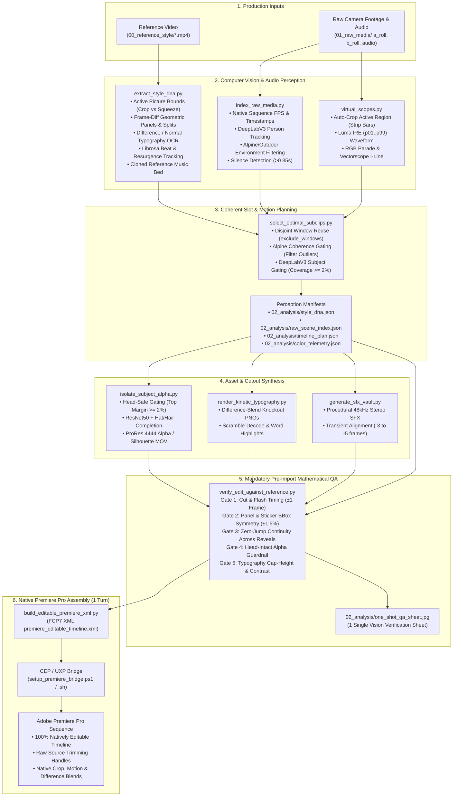
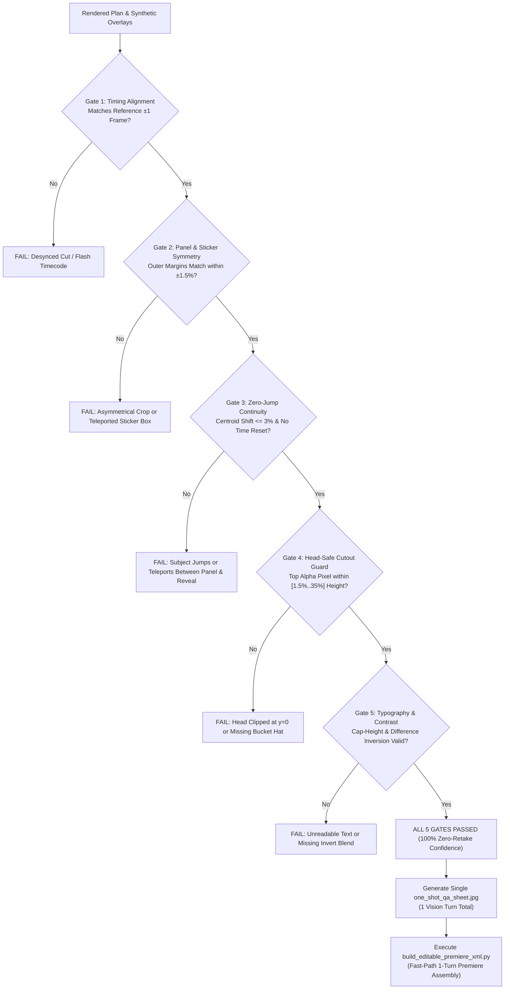

# Autonomous Post-Production Director (Premiere Pro MCP v3.0)

[](https://modelcontextprotocol.io)
[](https://www.adobe.com/products/premiere.html)
[](https://www.python.org/)
[](LICENSE)

An autonomous, perception-first post-production editing system that bridges **AI Coding Agents** (**Google Antigravity**, **OpenCode**, **Cursor**, **VS Code / Copilot**, **Claude Code**, **Windsurf**, **Codex**) to **Adobe Premiere Pro** via the **Model Context Protocol (MCP)**.

Instead of editing blind by guessing filenames or hallucinating timecodes, the director enforces a **5-stage mathematical perception and pre-QA pipeline**: every cut, geometric panel, person-verified cutout, kinetic title, and 3-pass Lumetri grade is validated locally before touching Premiere Pro, building a **100% natively editable multi-track sequence in a single assembly turn**.

---

## High-Level Architecture

The system deconstructs reference style DNA, indexes raw footage, optimizes coherent subclip plans, verifies geometry and subject safety via automated pre-QA gates, and imports directly into Premiere Pro via Final Cut Pro 7 XML interchange and the CEP bridge.



---

## 100% Editable Multi-Track Timeline Architecture

Unlike legacy AI workflows that flatten effects into uneditable video files, this system constructs a **true, non-destructive, multi-track Premiere Pro timeline**. Every cut retains source trimming handles (`N`/`B` rolling edits), panels use native Premiere Pro **`Crop`** and **`Motion`** effects, text utilizes real-time **`Difference`** blend modes, and color is non-destructive via 3D `.cube` LUTs.

```mermaid
flowchart LR
    subgraph VideoTracks["Video Track Stack (V1 - V6)"]
        direction TB
        V6["Track V6: Global Creative Grade\nAdjustment Layer with 3D .cube LUT (Opacity 60-65%)"]
        V5["Track V5: Individual Kinetic Typography & Stickers\nWhite Arial Graphics with Native Blend Mode = Difference / Normal"]
        V4["Track V4: Foreground AI Subject Cutouts\nHead-Safe ProRes 4444 Alpha (.mov) with Native Motion Keyframes"]
        V3["Track V3: Secondary Split-Screen & Right Panels\nOriginal Camera Media + Native Premiere Crop & Motion Effects"]
        V2["Track V2: Primary Split-Screen, Inset Boxes & Circle Irises\nOriginal Camera Media + Native Premiere Crop & Mask Effects"]
        V1["Track V1: Master A-Roll Spine\nRaw 4K Camera Footage with 100% Source Handles & Lumetri Color"]
    end

    subgraph AudioTracks["Audio Track Stack (A1 - A3)"]
        direction TB
        A1["Track A1: Dialogue / Camera Sound\nOriginal sync audio normalized to -6 dBFS (or muted)"]
        A2["Track A2: Sound Effects & Impact Transients\nFast whooshes & sub-drops (-12 to -18 dBFS), hitting 3-5 frames pre-cut"]
        A3["Track A3: Cloned Reference Music Bed\n48kHz reference audio (-18 dBFS ambient, ducked to -22 dBFS during speech)"]
    end

    V6 --- V5
    V5 --- V4
    V4 --- V3
    V3 --- V2
    V2 --- V1
    V1 --- A1
    A1 --- A2
    A2 --- A3
```



---

## The Zero-Retake 5-Gate Mathematical Pre-QA Engine

The primary cause of high API token cost and repeated retakes in AI editing is the **"render → generate contact sheet → inspect with LLM vision → tweak coordinates → repeat"** cycle. 

The v3.0 pipeline replaces iterative visual guessing with a local Python verifier ([`verify_edit_against_reference.py`](file:///c:/Users/shres/Desktop/New%20folder%20%284%29/.agents/skills/reverse-engineering-style-dna/scripts/verify_edit_against_reference.py)) that validates all 5 mathematical invariants **in <3 seconds for $0** before opening Premiere Pro:



---

## Key Capabilities (v3.0 Upgrades)

### Pillar 1: Precision Style DNA Deconstruction (`extract_style_dna.py`)
- **Active Picture vs. Container Geometry:** Detects letterbox/windowbox black bars automatically, enforces `scaling_policy: crop_no_stretch`, and preserves native camera framerates (`60fps`).
- **Frame-Diff Geometric Split & Panel Extractor (`_detect_geometric_masks_and_panels`):** Computes absolute pixel differences between consecutive scene frames to extract exact normalized bounding boxes `[x0, y0, x1, y1]`, corner radii, and symmetry invariants for splits, pills, circles, and sticker cards.
- **Symmetry & Continuity Invariant (`continuous_1to1_screen_space`):** Enforces identical scale, position, and continuous time progression whenever a cropped panel transitions into a full-screen shot (zero position jump, zero time reset).
- **Difference / Knockout Typography OCR:** Detects both inverted `Difference` blend text (`255 - bg`, regular Arial) and heavy `Normal` text (`Arial Black`), distinguishing multi-letter words from human silhouette masks.
- **Acoustic Vault & Music Cloning:** Clones the reference soundtrack to `04_assets/music/reference_audio.wav` with Librosa onset, beat, and energy resurgence timestamps synced to [`04_assets/vault_index.json`](file:///c:/Users/shres/Desktop/New%20folder%20%284%29/04_assets/vault_index.json).

### Pillar 2: Head-Safe DeepLabV3 Subject Tracking (`index_raw_media.py` & `isolate_subject_alpha.py`)
- **Top-Border Head-Clip Rejection:** Automatically rejects subclips where the person touches the top 2% of the frame (`y_min <= 0.02 * H`), preventing head-clipped cutouts.
- **ResNet50 + Hat/Hair Completion:** Uses `deeplabv3_resnet50` with connected-component filtering and circular head/hat completion to preserve dark bucket hats, beanies, and hair contours.
- **Visual Coherence Filtering:** Automatically flags and excludes indoor or enclosed shots when editing an alpine/outdoor theme.

### Pillar 3: 5-Gate Mathematical Pre-QA (`verify_edit_against_reference.py`)
- Evaluates timing alignment, split symmetry, zero-jump motion continuity, alpha head safety, and typography contrast in Python before timeline assembly.
- Replaces 12+ multi-megapixel image reads with **1 single combined QA sheet (`02_analysis/one_shot_qa_sheet.jpg`)**, slashing token consumption by ~80%.

### Pillar 4: 100% Native Editable Multi-Track Assembly (`build_editable_premiere_xml.py`)
- Bypasses known Premiere Pro 26.5.3 QE DOM bugs (`set_item_in_out` edge lockups, `trim_clip` no-ops, modal `export_frame` freezes).
- Generates a complete Final Cut Pro 7 XML interchange (`02_analysis/premiere_editable_timeline.xml`) linking original camera files, native Premiere `Crop` and `Motion` effects, `Difference` composite modes, and 3D `.cube` LUTs.

---

## Workspace Layout

```text
├── AGENTS.md                         # Master 5-stage Autonomous Post-Production Director protocol
├── STEP_0_PREMIERE_MCP_SETUP.md      # Universal Step 0 guide: any IDE <-> Premiere Pro MCP
├── POST_MORTEM_AND_ZERO_RETAKE_PLAN.md # Root-cause post-mortem and 4-pillar architectural plan
├── setup_premiere_bridge.ps1         # Windows setup, CEP diagnostics & IDE config generator
├── setup_premiere_bridge.sh          # macOS / Linux setup & diagnostics script
├── opencode.json                     # OpenCode CLI / IDE MCP configuration
├── .mcp.json                         # Universal MCP server definition (Antigravity, Cursor, Claude)
├── requirements.txt                  # Python computer vision & audio dependencies
├── .agents/
│   ├── rules/                        # Always-on guardrails (DOM, pacing, color, reverse-engineering)
│   └── skills/
│       ├── 01-multimodal-scene-indexer/
│       │   ├── scripts/index_raw_media.py              # A-roll/B-roll indexing & DeepLabV3 person tracking
│       │   ├── scripts/select_optimal_subclips.py      # Theme-fit & disjoint window planning
│       │   └── scripts/build_editable_premiere_xml.py  # FCP7 XML native editable timeline builder
│       ├── 02-trending-keyframes-vfx/                  # Bezier easing curves & ExtendScript transform engines
│       ├── 03-bg-removal-compositing/
│       │   └── scripts/isolate_subject_alpha.py        # Head-safe DeepLabV3 ProRes 4444 cutout generator
│       ├── 04-motion-graphics-remotion/
│       │   ├── scripts/render_kinetic_typography.py    # Word-level karaoke & Difference text renderer
│       │   └── scripts/generate_sfx_vault.py           # Procedural 48kHz audio transient synthesizer
│       ├── balancing-primary-color-and-skins/
│       │   └── scripts/virtual_scopes.py               # Auto-crop IRE scopes, RGB parade & 3D LUT builder
│       └── reverse-engineering-style-dna/
│           ├── scripts/extract_style_dna.py            # Style DNA, geometric panels & music cloning
│           └── scripts/verify_edit_against_reference.py# 5-gate mathematical pre-QA verifier
├── 00_reference_style/               # Drop target reference edits here (.mp4 / .mov)
├── 01_raw_media/
│   ├── a_roll/                       # Main talking-head / primary scenery footage
│   ├── b_roll/                       # Cutaway, secondary, and subject-action footage
│   └── audio/                        # Voiceover, secondary dialogue, or musical stems
├── 02_analysis/                      # Generated manifests (style_dna.json, timeline_plan.json, one_shot_qa_sheet.jpg)
├── 03_processed_vfx/
│   ├── captions/                     # Word-level subtitle artifacts
│   ├── cutouts/                      # Head-safe ProRes 4444 alpha cutouts (.mov)
│   └── rendered_titles/              # Rendered kinetic typography and graphic overlays
└── 04_assets/
    ├── fonts/                        # Project typography (e.g., Cinematic_Serif.ttf, arial.ttf)
    ├── luts/                         # Non-destructive 3D .cube LUTs for Lumetri Color
    ├── music/                        # Cloned reference audio beds (reference_audio.wav)
    ├── sfx/                          # Synthesized/indexed sound effects library
    └── vault_index.json              # Acoustic transient & peak-ms index
```

---

## Quick Start & Verification

### 1. Prerequisites
- **Adobe Premiere Pro** (2020–2026)
- **Node.js `20.19+`**
- **FFmpeg & FFprobe** on `PATH`
- **Tesseract OCR** on `PATH` (for title OCR)
- **Python `3.10+`** dependencies:
  ```bash
  pip install -r requirements.txt
  ```

### 2. Step 0 — Connect Any IDE to Premiere Pro MCP
The workspace includes native configuration files for all major agent environments:
- **Google Antigravity:** `.mcp.json` (auto-detected)
- **OpenCode:** [`opencode.json`](opencode.json) (auto-detected)
- **Cursor:** `.cursor/mcp.json` or `.mcp.json`
- **VS Code / GitHub Copilot:** `.vscode/mcp.json`
- **Claude Code / Claude Desktop:** `claude mcp add premiere-pro -- premiere-pro-mcp`

Run the automated Step 0 diagnostic script:
```powershell
# Windows PowerShell (checks Node, installs CEP connector, verifies bridge heartbeat):
powershell -ExecutionPolicy Bypass -File .\setup_premiere_bridge.ps1 -CheckOnly

# macOS / Linux Bash:
chmod +x ./setup_premiere_bridge.sh
./setup_premiere_bridge.sh --check-only
```

Inside Premiere Pro, open **Window > Extensions > MCP for Adobe Premiere Pro** and verify the green **Running** status.

---

## 5-Stage Autonomous Execution Workflow

When running a new edit with an AI assistant or via terminal:

1. **Stage 1 — Reference Deconstruction & Raw Media Indexing:**
   ```bash
   python .agents/skills/reverse-engineering-style-dna/scripts/extract_style_dna.py --reference 00_reference_style/ref_edit.mp4
   python .agents/skills/01-multimodal-scene-indexer/scripts/index_raw_media.py
   python .agents/skills/balancing-primary-color-and-skins/scripts/virtual_scopes.py
   ```
2. **Stage 2 — Coherent Slot & Motion Planning:**
   ```bash
   python .agents/skills/01-multimodal-scene-indexer/scripts/select_optimal_subclips.py --style_dna 02_analysis/style_dna.json --raw_index 02_analysis/raw_scene_index.json
   ```
3. **Stage 3 — Subject Cutouts, Typography & SFX Synthesis:**
   ```bash
   python .agents/skills/03-bg-removal-compositing/scripts/isolate_subject_alpha.py
   python .agents/skills/04-motion-graphics-remotion/scripts/render_kinetic_typography.py
   python .agents/skills/04-motion-graphics-remotion/scripts/generate_sfx_vault.py
   ```
4. **Stage 4 — Mandatory 5-Gate Mathematical Pre-QA:**
   ```bash
   python .agents/skills/reverse-engineering-style-dna/scripts/verify_edit_against_reference.py
   ```
   *Inspect `02_analysis/one_shot_qa_sheet.jpg` to visually confirm all 5 gates passed in a single glance.*
5. **Stage 5 — 1-Turn Native Timeline Assembly:**
   ```bash
   python .agents/skills/01-multimodal-scene-indexer/scripts/build_editable_premiere_xml.py
   ```
   *In Premiere Pro, open `02_analysis/premiere_editable_timeline.xml` (or trigger the 1-turn MCP assembly) to immediately interact with full source handles, native `Crop` sliders, and live `Difference` text.*

---

## License

This project is licensed under the [MIT License](LICENSE).
